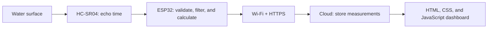

# Planned architecture

**Status:** initial design; software components have not been implemented yet.

The ECHO pulse will reach the ESP32 through the [voltage divider](wiring.md).

## What we will learn in each part

- **Measurement:** the sensor measures the sound's round-trip time, which is converted into distance.
- **Processing:** the ESP32 distinguishes valid readings from failures, reduces fluctuations, and applies the container calibration.
- **Connection:** Wi-Fi provides network access; HTTPS enables encrypted data exchange with the service.
- **Storage:** the cloud retains the history even when the dashboard is not open on the computer.
- **Visualization:** the browser retrieves the history and presents the data to the user.

Measuring and uploading are tasks with different frequencies. We will select their intervals after checking sensor stability and platform limits; continuous measurement does not require uploading every reading.

## Design rules

- A reading with no echo does not mean the container is empty.
- Clamping a percentage to 0–100% does not make an impossible reading valid.
- Height percentage uses the empty and full reference distances; volume also requires known geometry or calibration with known volumes.
- Measurement time and reception time will be distinguished if both are used.
- The dashboard must indicate when the latest measurement is stale.
- Credentials that allow writes will remain outside the repository and the code delivered to the browser.

The cloud platform and measurement record fields will be finalized in Stage 4. No database has been created and no service has been deployed yet.
